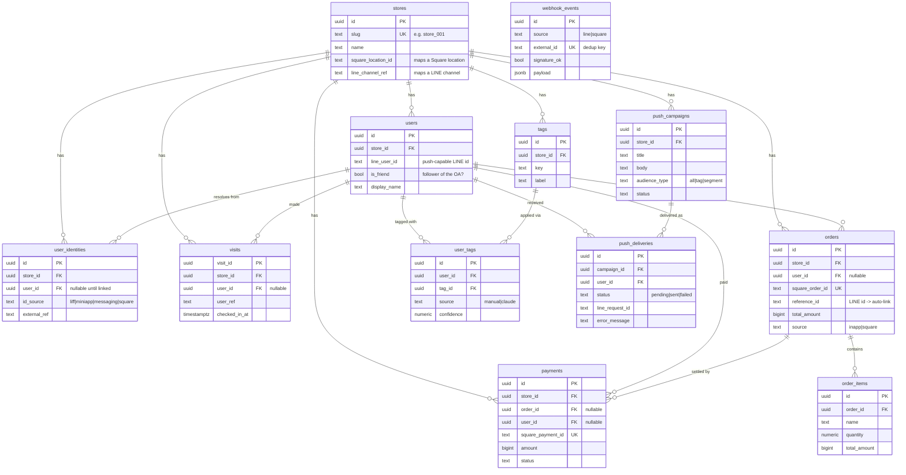

# Cozene — Database Design

The database captures **who a customer is**, **what they do** (visit / order / pay), and
**what we send them** (LINE push), so the store can re-engage customers based on behavior.

Design principles:
- **Store-agnostic** — every business table carries `store_id`; one deployment serves many venues.
- **Idempotent ingest** — external ids (Square order/payment, webhook event) are `UNIQUE`, so
  replays and retries never create duplicates (writes are upserts).
- **Identity is decoupled** — behavior rows never block on knowing the customer yet; `user_id`
  is nullable and linked when resolvable.
- **Debuggable** — every externally-sourced row keeps the raw JSON payload (`raw` / `raw_payload`).

> Source of truth: [`db/migrations/0001_phase2.sql`](./migrations/0001_phase2.sql). This document
> describes it in plain language — if they ever disagree, the SQL wins.

---

## The five groups

| Group | Tables | Question it answers |
|---|---|---|
| **Identity** | `stores`, `users`, `user_identities` | Who is this customer, and can we message them? |
| **Behavior** | `visits`, `orders`, `order_items`, `payments` | What did they do / buy / pay? |
| **Segmentation** | `tags`, `user_tags` | Which group do they belong to? |
| **Messaging** | `push_campaigns`, `push_deliveries` | What did we send, and did it arrive? |
| **Plumbing** | `webhook_events` | Raw inbound events (idempotency + audit). |

---

## Entity-relationship diagram



> The diagram renders automatically on GitHub and in most IDE Markdown previews. `PK` = primary
> key, `FK` = foreign key, `UK` = unique. `o{` means "many".

---

## Identity — the important part

`users` is keyed on the **LINE `userId`** — the only id that can receive a push. Because the
LIFF login channel and the Messaging API channel are **linked under one provider**, the id you
get at check-in is the same id you push to.

`user_identities` is the bridge for everything that *isn't* natively a LINE id — a Square
customer, a future Mini App id, etc. Each source reference is stored once and points at a
`users` row **when known** (`user_id` may be `NULL` until a follow event or a manual link fills
it in). This is why ingest never has to wait for identity to be resolved.

```
   LIFF check-in ─┐
   LINE follow  ──┤→ user_identities (id_source, external_ref) ──→ users (line_user_id)  ← push target
   Square order ─┘        (user_id nullable = not linked yet)
```

---

## Table reference

### stores
One venue. `slug` maps the Phase-1 string id (`store_001`); `square_location_id` and
`line_channel_ref` let inbound webhooks find the right store.

| Column | Type | Notes |
|---|---|---|
| id | uuid PK | |
| slug | text | **unique** — matches `web/config.js` `STORE_ID` |
| name | text | |
| square_location_id | text | resolves Square webhooks → this store |
| line_channel_ref | text | resolves LINE webhooks → this store |
| created_at | timestamptz | |

### users
A push-capable customer within a store.

| Column | Type | Notes |
|---|---|---|
| id | uuid PK | |
| store_id | uuid FK → stores | |
| line_user_id | text | the push id; `UNIQUE (store_id, line_user_id)` |
| display_name | text | from the LINE profile |
| is_friend | bool | follower of the Official Account (only friends are pushable) |
| followed_at / unfollowed_at | timestamptz | set by the LINE webhook |
| created_at / updated_at | timestamptz | |

### user_identities
Links any source reference to a user. `UNIQUE (store_id, id_source, external_ref)`.

| Column | Type | Notes |
|---|---|---|
| id | uuid PK | |
| store_id | uuid FK → stores | |
| user_id | uuid FK → users | **nullable** = not linked yet |
| id_source | text | `liff` \| `miniapp` \| `messaging` \| `square` |
| external_ref | text | the raw id from that source |
| linked_at | timestamptz | when it was linked to a user |

### visits
One QR check-in. Phase-1 compatible.

| Column | Type | Notes |
|---|---|---|
| visit_id | uuid PK | |
| store_id | uuid FK → stores | |
| user_ref | text | raw source id, as sent by the client |
| id_source | text | `liff` \| `miniapp` |
| user_id | uuid FK → users | nullable |
| checked_in_at | timestamptz | |
| raw_payload | jsonb | debug |

### orders
One order, from in-app ordering or Square. `UNIQUE (store_id, square_order_id)`.

| Column | Type | Notes |
|---|---|---|
| id | uuid PK | |
| store_id | uuid FK → stores | |
| user_id | uuid FK → users | nullable |
| square_order_id | text | idempotency key |
| square_location_id | text | |
| reference_id | text | the LINE id stamped at order time → **auto-links** to a user |
| state | text | OPEN / COMPLETED / CANCELED |
| total_amount | bigint | minor units (whole yen for JPY) |
| currency | text | default `JPY` |
| source | text | `inapp` \| `square` |
| ordered_at / closed_at | timestamptz | |
| raw | jsonb | full Square order |

### order_items
Line items of an order (cascades on order delete). `UNIQUE (order_id, square_uid)`.

| Column | Type | Notes |
|---|---|---|
| id | uuid PK | |
| order_id | uuid FK → orders | |
| store_id | uuid FK → stores | |
| square_uid | text | Square line-item uid |
| name / quantity / unit_amount / total_amount / category | | |
| raw | jsonb | |

### payments
A Square payment. `UNIQUE (store_id, square_payment_id)`.

| Column | Type | Notes |
|---|---|---|
| id | uuid PK | |
| store_id | uuid FK → stores | |
| order_id | uuid FK → orders | nullable |
| user_id | uuid FK → users | nullable (inherited from the order) |
| square_payment_id | text | idempotency key |
| square_order_id | text | join back to the order |
| amount / currency / status | | APPROVED / COMPLETED / FAILED |
| paid_at | timestamptz | |
| raw | jsonb | |

### tags
A segment definition. `UNIQUE (store_id, key)`.

| Column | Type | Notes |
|---|---|---|
| id | uuid PK | |
| store_id | uuid FK → stores | |
| key | text | machine name, e.g. `high_spender` |
| label | text | human name |
| description | text | |

### user_tags
Which customers have which tags. `UNIQUE (user_id, tag_id)`.

| Column | Type | Notes |
|---|---|---|
| id | uuid PK | |
| user_id | uuid FK → users | cascades |
| tag_id | uuid FK → tags | cascades |
| source | text | `manual` now; `claude` for Phase-3 auto-tagging |
| confidence | numeric | Claude score (nullable) |
| assigned_at | timestamptz | |

### push_campaigns
One push send.

| Column | Type | Notes |
|---|---|---|
| id | uuid PK | |
| store_id | uuid FK → stores | |
| title | text | internal name |
| body | text | the message text |
| audience_type | text | `all` \| `tag` \| `segment` |
| audience_spec | jsonb | e.g. `{ "tag_ids": [...] }` |
| status | text | draft / scheduled / sending / sent / failed |
| scheduled_at | timestamptz | reserved for Phase-3 scheduling |
| created_by | text | admin email |
| sent_at | timestamptz | |

### push_deliveries
One row **per recipient** — this powers the results dashboard and future retries.
`UNIQUE (campaign_id, user_id)`.

| Column | Type | Notes |
|---|---|---|
| id | uuid PK | |
| campaign_id | uuid FK → push_campaigns | cascades |
| user_id | uuid FK → users | |
| line_user_id | text | snapshot of the target id |
| status | text | pending / sent / failed |
| line_request_id | text | LINE `X-Line-Request-Id` |
| error_code / error_message | text | on failure |
| sent_at | timestamptz | |

### webhook_events
Raw inbound LINE/Square events. `UNIQUE (source, external_id)` dedups replays.

| Column | Type | Notes |
|---|---|---|
| id | uuid PK | |
| source | text | `line` \| `square` |
| event_type | text | `follow`, `order.created`, … |
| external_id | text | LINE `webhookEventId` / Square `event_id` |
| store_id | uuid FK → stores | resolved if possible |
| signature_ok | bool | did signature verification pass |
| payload | jsonb | the raw event |
| processed_at | timestamptz | NULL = not yet handled (retryable) |
| received_at | timestamptz | |

---

## `specials` — the weekly special menu

One dish per store per week. `UNIQUE (store_id, week_start)` means re-saving the
same week edits it in place rather than creating a second row.

| Column | Type | Notes |
|---|---|---|
| id | uuid | PK |
| store_id | uuid | FK stores |
| week_start | date | Monday of the week it runs |
| title | text | dish name shown to the guest |
| description | text | optional blurb under the photo |
| image_url | text | public https URL, loaded in the LINE browser |
| status | text | `draft` / `active` / `archived` |

## `special_ratings` — guest feedback

Written by the post-payment screen. `UNIQUE (special_id, user_id)` keeps exactly
one row per guest, so changing your answer overwrites instead of double-counting.

| Column | Type | Notes |
|---|---|---|
| id | uuid | PK |
| store_id | uuid | FK stores |
| special_id | uuid | FK specials, ON DELETE CASCADE |
| user_id | uuid | FK users |
| user_ref | text | LIFF userId as sent |
| rating | text | `good` / `ok` / `bad` (CHECK constraint) |
| comment | text | optional free text (no UI yet) |
| order_id | uuid | the paid order that prompted it, when known |
| source | text | `liff` / `miniapp` / `admin` |
| rated_at | timestamptz | |

---

## How data flows in

| Trigger | Endpoint | Writes |
|---|---|---|
| QR check-in | `POST /api/checkin` | `visits` (+ upsert `users`, `user_identities`) |
| Follows the OA | `POST /api/webhooks/line` | `users.is_friend = true`, `webhook_events` |
| Places in-app order | `POST /api/order` | `orders` (`source=inapp`, linked), `order_items` |
| Square order/payment | `POST /api/webhooks/square` | `orders` / `order_items` / `payments` (auto-link via `reference_id`), `webhook_events` |
| Admin sends push | `POST /api/push/send` | `push_campaigns` + one `push_deliveries` per recipient |
| Admin assigns tag | `POST /api/tags/assign` | `user_tags` |
| Guest rates the special | `POST /api/specials/rate` | `special_ratings` (+ upsert `users`, `user_identities`) |
| Owner sets the week's dish | `POST /api/specials` | `specials` (upsert on the week) |

## Roadmap hooks already in the schema

- **Phase 3 auto-tagging** — `user_tags.source='claude'` + `confidence` are ready; Claude writes
  to the same table the admin UI reads.
- **Scheduled sends** — `push_campaigns.scheduled_at` exists; only a cron worker is missing.
- **Rating-driven push** — `push_campaigns.audience_type='rating'` with
  `audience_spec={special_id, ratings[]}` targets guests by how they rated a dish.
- **Mini App migration** — `id_source='miniapp'` is already a valid identity source; swap the
  client id, nothing else changes.
